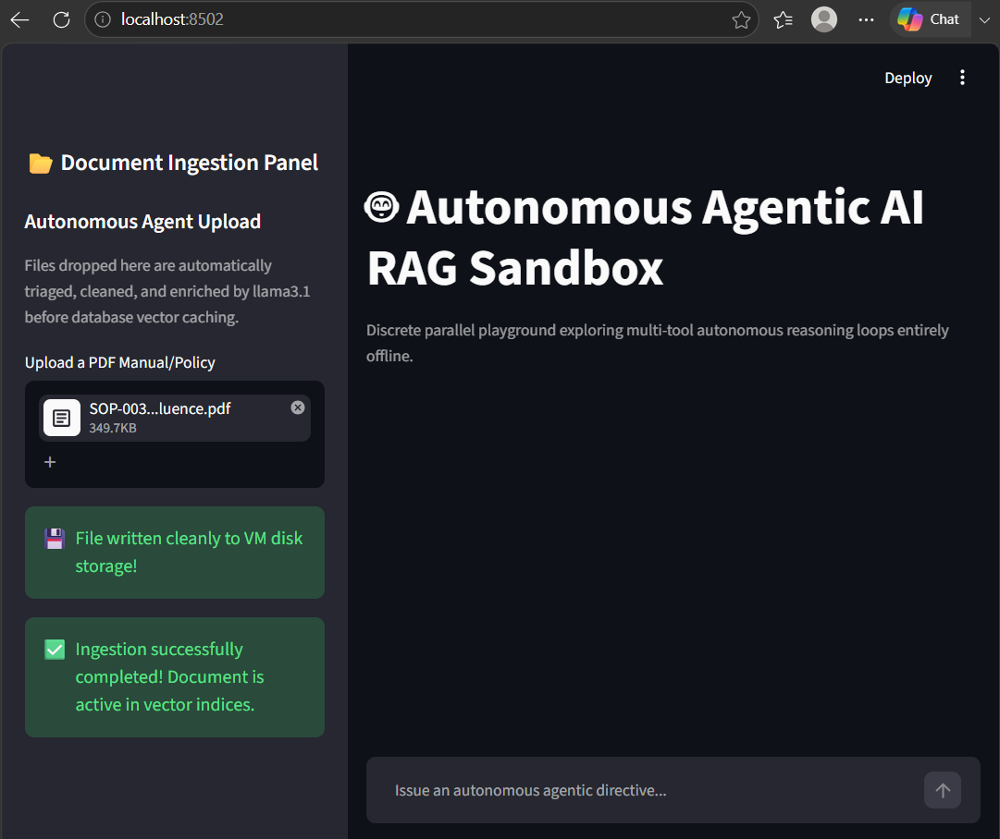
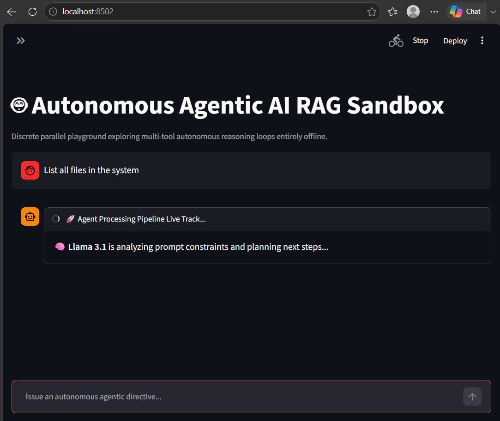
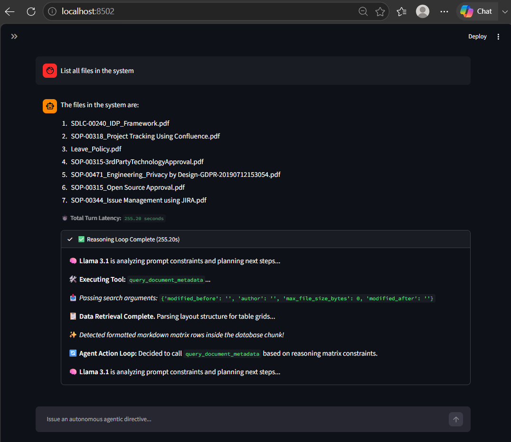
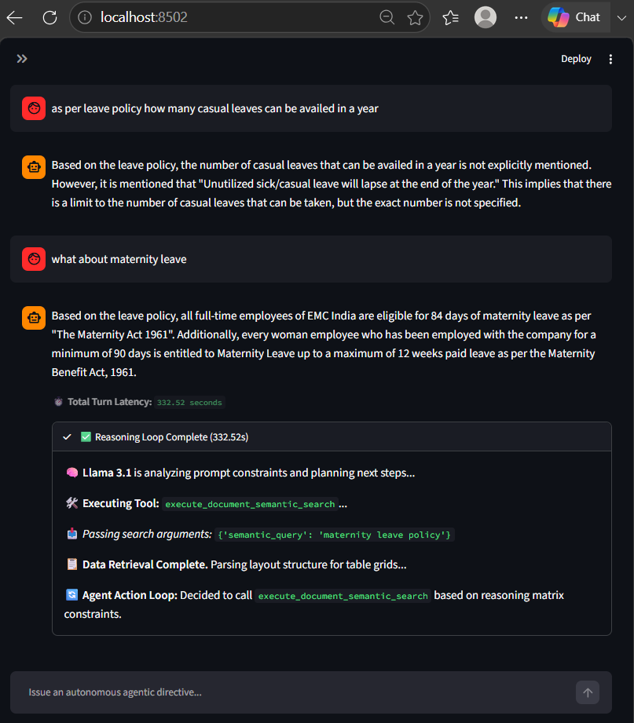

# 📖 END-USER OPERATIONAL MANUAL

## 1. Launching the Sandbox Dashboard

Open your preferred web browser and head to the standard Streamlit interface link:
```text
URL Location: http://localhost:8502 (or http://<your-host-ip>:8502)
```
Once the page initializes, you will see the 🤖 Autonomous Agentic AI RAG Sandbox query workstation workspace, along with an expandable multi-tool operations tracing monitor.

## 2. Executing Multi-File Document Ingestion

The ingestion pipeline runs on Zero-LLM-Overhead architecture, bypassing heavy sequential token calls entirely to ensure processing completes in seconds.
* Step 1: Expand the left-hand panel titled 📂 Document Ingestion Panel.
* Step 2: Upload any targeted PDF corporate manual or policy guidelines document (e.g., SDLC-00240_IDP_Framework.pdf).
* Step 3: The file is immediately written to the container's shared disk space. The backend Celery Worker pulls the job off the Redis queue, leverages pdfplumber to structure complex text or layout tables, embeds the content via nomic-embed-text, and stores it into the persistent pgvector index layout.
* Step 4: You can monitor the background ingestion traces in real time on your terminal host using: docker compose logs -f rag-celery-worker.



## 3. Querying the Sandbox Using Context Triggers

The system has been programmatically enhanced to route queries elegantly based on two specific interaction models:

### A. Structured Tabular Lookup (Sub-Second Turnaround)

When pulling dense matrices, version tables, or change logs, include parts of the specific document code name identifier directly in your text query string.
* Optimal Query Example: `"List the revision history table for the SDLC-00240 IDP Framework file."*
* How it processes: The agent reads your text, identifies the unique partial name tokens ['sdlc', '00240'], and uses an explicit AND intersection constraint inside the database query. This completely prevents cross-file data leakage (e.g., ignoring your GDPR or Privacy documents), groups rows using the Adaptive Accumulator, and triggers an express Python short-circuit to output a pristine, clean Markdown data grid onto your Streamlit display instantly.




### B. Brief Conversational Follow-Up Queries (Pronoun Resolution)

Because the state engine feeds your historical interaction log down into the active token layer on every execution turn, the system maintains complete continuity for conversational follow-up inputs.
* Query Turn 1: `"Who can move an issue under JIRA Issue Management regulations?"*
* Query Turn 2 (Follow-Up Shortcut): `"What about Create Issue?"*
* How it processes: Rule 5 (Context Resolution) activates immediately. Instead of panic-routing to a generic file lookup for "Create Issue", Llama 3.1 reviews your active chat_history, registers that you are still inquiring about the JIRA SOP document, automatically reformulates its internal search payload target parameters, and fetches the matching policy answers in single-digit seconds.


### C. Reading the Live Activity Tracker Widget

While waiting for a query to complete, you can expand the 🚀 Agent Processing Pipeline Live Track... tray directly inside the assistant message block to view background steps:

| Logged Output Status | Operational Event Context Description |
|---|---|
| 🧠 Llama 3.1 is analyzing prompt constraints... |	The model is planning its research strategy and evaluating history.|
| 🛠️ Executing Tool: fallback_regex_keyword_search... |	The engine has chosen a custom fallback tool to inspect relational Postgres tables.|
| 🎯 Strict SQL Isolation applied for target criteria...	 | The dynamic filename filter has isolated a specific file name inside the database.|
| ✨ Detected formatted markdown matrix rows... |	The tool has successfully extracted a markdown data layout and is passing it back.|
